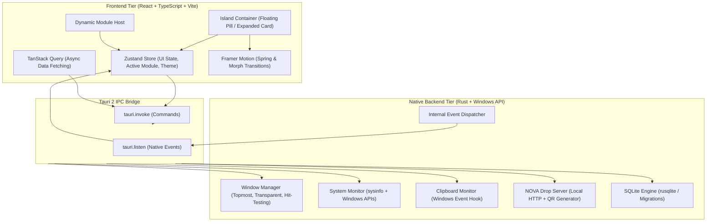

# NOVA System Architecture

**Document ID:** NOVA-ARCH-001  
**Architecture Style:** Modular Monolith (Native Windows Desktop)  
**Core Frameworks:** Tauri 2 (Rust) + React 19 + TypeScript + Vite  

---

## 1. High-Level Architecture Overview

NOVA is partitioned into two cooperating tiers:



---

## 2. Window Architecture & Native Management

### 2.1 Island Window (Primary)
- **Visual Style:** Frameless, transparent background (`rgba(0,0,0,0)`), always on top (`WS_EX_TOPMOST`).
- **Positioning:** Centered horizontally at $(Screen.Width / 2) - (Window.Width / 2)$, top edge at $y = 0$ (or slight notch offset).
- **Hit-Testing:** In Windows, a transparent layered window must pass through mouse clicks when in collapsed state outside the active pill. We dynamically adjust window size and click-through regions via native Windows messages (`WM_NCHITTEST` / `SetWindowRgn` / Tauri `set_size` & `set_position`).
- **Expansion Mechanics:** 
  1. Frontend detects mouse entering the pill hitbox.
  2. Frontend communicates expansion intent to Rust backend (`expand_island`).
  3. Window size is expanded to accommodate the full workspace (e.g. 640x440px).
  4. Framer Motion animates the internal pill into the full workspace card.
  5. On mouse exit (after collapse delay and verifying no input has focus), window shrinks back to capsule dimensions (e.g. 180x36px).

### 2.2 Secondary Windows (On Demand)
- **Settings Window:** Resizable standard utility window for comprehensive configuration, themes, module management, and privacy controls.
- **NOVA Drop Companion:** Clean web interface served over local LAN for scanned mobile devices.

---

## 3. Modular Monolith & Registry

Each module conforms to a strict contract:

```typescript
export interface NovaModule {
  id: string;
  name: string;
  category: 'everyday' | 'files' | 'time' | 'desktop' | 'specialist';
  icon: string;
  version: string;
  enabledByDefault: boolean;
  permissions: string[];
  settingsSchema?: Record<string, unknown>;
  renderWidget?: React.ComponentType;
  renderView: React.ComponentType;
}
```

Modules register into a centralized `ModuleRegistry`, enabling instant toggle, settings persistence, and isolation.
